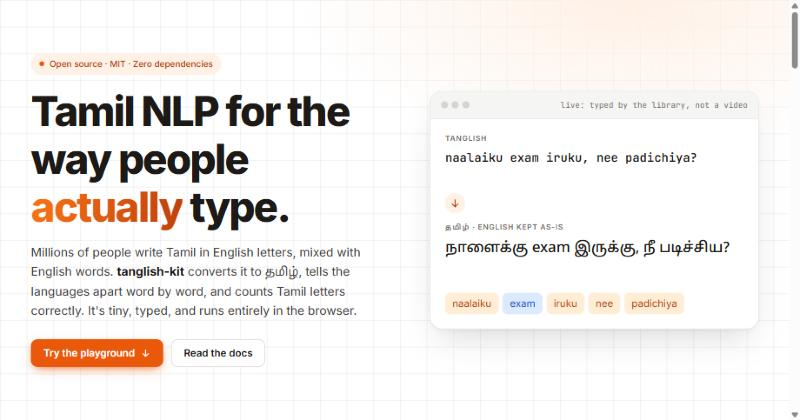

# tanglish-kit

**Type Tanglish, get தமிழ்.** A zero-dependency TypeScript toolkit for Tamil and code-mixed Tanglish text:
phonetic transliteration, reversible romanization, word-level language detection and Tamil letter analysis.

[](https://github.com/Saffiya-7/tanglish-kit/actions/workflows/ci.yml)


**[▶ Live demo](https://comfy-puppy-3e5a16.netlify.app)**: everything runs in your browser, nothing is uploaded.



## Why

Millions of Tamil speakers type Tamil in English letters, mixed with English words:
*"machan meeting cancel aachu, naalaiku pesalam"*. Most NLP tools break on this. They treat it as bad English,
or they transliterate the English words too. `tanglish-kit` handles the mix:

```js
tanglishToTamil('machan meeting cancel aachu', { keepEnglish: true });
// → 'மச்சான் meeting cancel ஆச்சு'
```

It's useful for cleaning chat or social-media data before it goes to an LLM or classifier, building Tamil
input methods, search over mixed-script text, and anything that needs to count Tamil letters correctly.

## Features

| | |
|---|---|
| **Tanglish → Tamil** | Context-aware phonetic rules (ந/ன/ண, ங்க, ஞ்ச, ற்ற, ன்ற, glides like *naai → நாய்*) plus a lexicon of common chat words |
| **Tamil → Tanglish** | `casual` style that reads like real Tanglish (*adhu, nagaram, anbu*) or a `precise` style that converts back to the exact same Tamil |
| **Language detection** | Tags every word in a code-mixed sentence as `tanglish` / `en` / `tamil`, using a character n-gram Naive Bayes model with neighbour smoothing |
| **Letter analysis** | Splits text into real Tamil letters (`"தமிழ்".length` is 5, but it has 3 letters), and labels each as உயிர் / மெய் / உயிர்மெய், குறில் / நெடில், வல்லினம் / மெல்லினம் / இடையினம் |
| **Utilities** | Tamil numerals ⇄ digits, Unicode normalisation (NFC and zero-width cleanup) |
| **CLI** | `tanglish "vanakkam"` for quick conversions and piping files |

## Install

```bash
npm install github:Saffiya-7/tanglish-kit
```

Works in Node ≥ 18 and every modern browser (ESM, ~78 KB minified including the model).

## Usage

```ts
import {
  tanglishToTamil, tamilToTanglish, tagWords, detectLanguage, splitLetters, analyzeText,
} from 'tanglish-kit';

tanglishToTamil('vanakkam nanba, epdi irukeenga?');
// 'வணக்கம் நண்பா, எப்டி இருக்கீங்க?'

tamilToTanglish('வணக்கம் நண்பா');                     // 'vanakkam nanbaa'
tamilToTanglish('வணக்கம்', { style: 'precise' });       // 'vaNakkam' (converts back exactly)

tagWords('office ku late aachu').map((t) => `${t.word}:${t.lang}`);
// ['office:en', 'ku:tanglish', 'late:en', 'aachu:tanglish']

detectLanguage('naalaiku exam iruku, nee padichiya?');
// { tamil: 0, tanglish: 0.8, en: 0.2, dominant: 'tanglish', codeMixed: true }

splitLetters('தமிழ்');   // ['த', 'மி', 'ழ்']
analyzeText('தமிழ்');    // { letters: 3, mei: 1, uyirmei: 2, kuril: 2, vallinam: 1, ... codePoints: 5 }
```

### `tanglishToTamil` options

| option | default | |
|---|---|---|
| `keepEnglish` | `false` | Leave words the model tags as English untouched |
| `useLexicon` | `true` | Use the built-in dictionary of common Tanglish words |
| `caseSensitive` | `true` | Capitals pick letters: `N`=ண `L`=ள `R`=ற `S`=ஸ `E`=ஏ `O`=ஓ |
| `fixAutoCaps` | `true` | Ignore phone auto-capitalisation (`Enna` is read as `enna`) |
| `tamilNumerals` | `false` | Output ௧௨௩ instead of 123 |

### Typing scheme

| Type | Get | Example |
|---|---|---|
| `aa` `ee` `oo` | ஆ ஈ ஊ | paal → பால், nee → நீ, poo → பூ |
| `E` `O` | ஏ ஓ | Eri → ஏரி, Odu → ஓடு |
| `zh` | ழ | thamizh → தமிழ் |
| `N` `L` `R` | ண ள ற | kaNNu → கண்ணு, paLLi → பள்ளி |
| `ng` `nj` `ndh` `nd` | ங்க ஞ்ச ந்த ண்ட | enga, konjam, vandhu, rendu |
| `tr` `ndr` | ற்ற ன்ற | kaatru → காற்று, nandri → நன்றி |
| `ch` between vowels | ச்ச | pachai → பச்சை (while pasi → பசி) |
| `S` `sh` `j` `h` `ksh` `f` | ஸ ஷ ஜ ஹ க்ஷ ஃப | Sree → ஸ்ரீ, kashtam → கஷ்டம் |

### CLI

```bash
tanglish "vanakkam nanba"               # வணக்கம் நண்பா
tanglish -r "நன்றி"                      # nandri
tanglish -r -p "நன்றி"                   # nanRi  (precise)
tanglish -e "meeting cancel aachu"      # meeting cancel ஆச்சு
tanglish -t "office ku late"            # per-word language tags with confidence
cat chat.txt | tanglish > chat.ta.txt   # stdin → stdout
```

## How the language detector works

Each Latin word is broken into character 1–4-grams with boundary markers (`^va`, `kam$`, ...), then scored by a
two-class multinomial Naive Bayes model (Tanglish vs English). Tanglish has telling patterns like `zh`, `aa`,
`ng$` and `-kku`, and English has its own like `-tion`, `th`, `-ing` and silent `e`. Because code-mixed
sentences switch languages in runs, each word's score is blended with its neighbours', so a short word like
`la` or `so` follows the words around it. Words in the lexicon are always Tanglish.

The model is plain JSON trained by [`scripts/train-langid.ts`](scripts/train-langid.ts) from the word lists in
[`data/`](data). Retrain it with `npm run train`, or pass your own to `tagWords(text, { model })`.

| Evaluation | Result |
|---|---|
| Unseen words (deterministic 80/20 split, 214 words) | **97.7%** |
| Hand-labelled code-mixed sentences (139 tokens), no context | 97.1% |
| Same sentences, with neighbour smoothing | **99.3%** |

The sentence evaluation retrains the model with **every word in those sentences removed**, so these are unseen
words. The lexicon still applies, as it does in real use. The data set is small (about 1,100 training words), so
treat these as rough numbers. More labelled data is the best way to help (see Contributing).

## Project structure

```
src/
  transliterate.ts   Tanglish → Tamil phonetic engine
  romanize.ts        Tamil → Tanglish (casual / precise)
  letters.ts         Tamil letter splitting & classification
  lexicon.ts         Common-word dictionary
  langid/            Naive Bayes language ID + generated model
  tamil.ts           Unicode tables, numerals, normalisation
  cli.ts             Command-line interface
data/                Training word lists, eval sentences, metrics.json
scripts/             Model training, site build
site/                Demo website (deployed to Netlify)
test/                Vitest suite (115 tests, incl. 35 Tamil → Tanglish → Tamil round trips)
```

## Development

```bash
npm install
npm test            # run the test suite
npm run train       # retrain the language model and print accuracy
npm run dev         # demo site with live reload on http://localhost:8000
npm run build       # compile the library to dist/
```

## Roadmap

- [ ] Publish to npm as `tanglish-kit`
- [ ] Python port (`pip install tanglish-kit`) for data-science pipelines
- [ ] Larger labelled data set from public Tamil social-media corpora
- [ ] Ranked transliteration suggestions (top-k candidates per word)
- [ ] Tanglish sentiment classifier
- [ ] Browser extension: type Tanglish in any text box

## Contributing

Issues and PRs are welcome, especially:

- **Lexicon entries** for common words the rules get wrong (`src/lexicon.ts`)
- **Labelled words and sentences** in `data/` (then run `npm run train` and include the new accuracy)
- Bug reports with the input, what you got, and what you expected

## License

[MIT](LICENSE)
